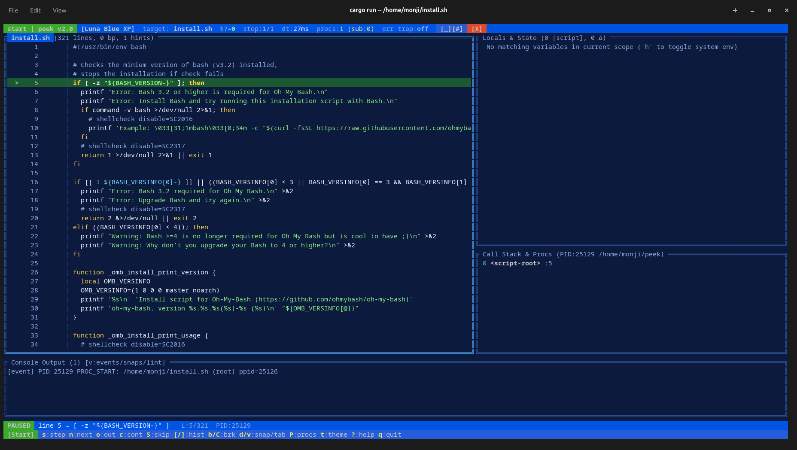

<div align="center">

# peek (`bash-peek`) v2.0.0

**Interactive TUI debugger, line-level profiler, static analyzer, and time-travel inspector for Bash scripts.**

[](https://crates.io/crates/bash-peek)
[](LICENSE)
[](https://www.gnu.org/software/bash/)
[](https://github.com/monji024/peek)

</div>

---

Debugging a 2,000-line Bash script usually means littering the file with `echo "HERE"` or turning on `set -x` and watching thousands of lines of unreadable trace scroll past your terminal. `bashdb` exists, but stepping through complex scripts in a raw CLI prompt without live variable diffs or stack visibility gets painful fast.

**`peek` v2.0** wraps your script in an isolated `DEBUG` trap harness and connects it to a Rust `ratatui` interface over UNIX FIFOs, kernel file locks, and optional local Unix domain sockets (`0600`). You get live local and environment state inspection, separate-terminal attach, multi-process tracking, static pitfall analysis, filesystem snapshots & diffs, per-line execution timing, reverse step history, interactive TTY handoff, and dry-run command skipping—without touching a single line of the target script.

<p align="center">
  
</p>

## ▸ Features

* **Zero-Modification Attach:** Run `peek ./deploy.sh --arg1 val` directly. `$0` (`BASH_ARGV0`), `$@`, `$SECONDS`, `$?`, `PIPESTATUS`, user-defined `DEBUG` and `EXIT` traps, `shopt` options (`nocasematch`, `extglob`, `nullglob`, virtualized `extdebug`), and `set -euo pipefail -f` semantics are preserved transparently without leaking harness internals into the variable or call-stack panes.
* **Separate-Terminal Debugging (`--listen` / `--attach`):** Run a Bash application in its native terminal (`peek --listen ./app.sh`) and attach/detach the TUI controller from another terminal (`peek --attach`) over a versioned, hex-framed Unix domain socket (`PEEK_V1`) with `0600` permissions, `HOST_PID`/`CHILD_PID` ownership verification, `PR_SET_PDEATHSIG` orphan protection, and automatic stale-socket cleanup (`peek --list-sessions`).
* **Multi-Process Bash Tracking:** Child and grandchild Bash scripts spawned by the entry script automatically inherit the instrumentation agent via `BASH_ENV`, reporting `PROC_START` / `PROC_EXIT` lifecycle events and per-PID execution frames (`P` to inspect the process tree and cycle active processes).
* **Static Bash Pitfall & Security Analyzer:** Automatically inspects loaded scripts for common shell hazards (`PK001` unguarded `rm -rf`, `PK002` dynamic `eval`, `PK003` unchecked `cd`, `PK004` legacy backticks, `PK005` masked `local var=$(...)` exit codes, `PK006` `read` without `-r`), flagging affected lines in the gutter (`!`) and in the **Script Diagnostics** pane (`v`).
* **In-Bash Fast Path:** Breakpoint matching, call-stack depth checks (`next` / `out`), error traps (`$? != 0`), and conditional expressions are evaluated natively inside the Bash hook before serializing state. Loops run at near-native speed until a trap condition hits.
* **Subshell & Pipeline Stepping (`flock`):** Step directly into `$(...)` command substitutions and pipeline subshells (`s` to step into child shells, `n` to step over). Concurrent subshell frames open per-`$BASHPID` lock descriptors (`flock`) to guarantee atomic frame writes without FIFO interleaving.
* **Fullscreen & Interactive TTY Handoff (`tcsetpgrp`):** When the target script invokes an interactive terminal program (`vim`, `nvim`, `nano`, `fzf`, `dialog`, `whiptail`, `less`, `htop`, `ssh`)—or when you press `T` (`Shift+t`) on any command—`peek` cleanly suspends the TUI, transfers foreground `/dev/tty` process-group ownership to the child without triggering `SIGTTOU`/`SIGTTIN`, and restores the debugger layout as soon as the utility exits.
* **Time-Travel Ring Buffer:** Scrub backward and forward (`[` / `]`) through the last 256 execution frames per process to see how variables, exit codes, and call stacks evolved prior to a failure.
* **Optional Filesystem Snapshots & Diffs:** Capture bounded, symlink-safe snapshots of the working directory or a configured scope (`d` / `D` or `--snapshot-dir`) and inspect `+` added, `~` modified, and `-` deleted files across execution steps.
* **Structured Event Timeline:** Inspect sequence-numbered, timestamped session events (`PROC_START`, `PROC_PAUSE`, `PROC_RESUME`, `PROC_EXIT`, `DBG_ATTACH`, `SNAP_CAPTURE`, `SNAP_DIFF`) in the bottom pane (`v` to switch views).
* **Automatic Credential Redaction:** Sensitive variables (`*PASSWORD*`, `*SECRET*`, `*TOKEN*`, `*API_KEY*`, `ghp_*`, `sk-*`, `AKIA*`, Bearer tokens) and command arguments are masked by default in the TUI and exported reports (`M` to toggle raw view).
* **Windows XP Luna Blue & Multi-Theme Terminal UX:** Features a handcrafted **Luna Blue XP** default theme (Royal Blue titlebar, Olive Green `[Start]` badge, Warm Coral window accents, and double-line borders) alongside **Classic** and **Terminal Native** modes (`t` or `--theme`), adapting automatically to `NO_COLOR`, 16-color, 256-color, and truecolor terminals without requiring Nerd Fonts.

## ▸ Installation

### Using Cargo (crates.io)

```bash
cargo install bash-peek
```

### Building from Source

```bash
git clone https://github.com/monji024/peek.git
cd peek
cargo build --release
sudo install -Dm755 target/release/peek /usr/local/bin/peek
```

> **Requirements:** **Bash 4.1+** (tested through Bash 5.2; uses `{fd}>` dynamic descriptor allocation and `$BASHPID`), **Rust 1.74+** (2021 edition), and `flock` (`util-linux` on Linux).

## ▸ Quick Start

```bash
# Start debugging a script paused at the first executable statement
peek ./script.sh

# Pass arguments through to the target script ($1, $2, ...)
peek ./deploy.sh --env staging --force

# Pre-configure line breakpoints and automatically pause whenever $? != 0
peek -b 45,120 -e ./backup.sh

# Separate-terminal workflow:
# Terminal 1 (runs script with native stdout/stderr/tty):
peek --listen deploy-sess ./deploy.sh
# Terminal 2 (attaches TUI debugger over Unix domain socket):
peek --attach deploy-sess

# List active sessions and clean up stale/orphaned sockets
peek --list-sessions
```

```text
Usage: peek [OPTIONS] [SCRIPT] [ARGS]...

Arguments:
  [SCRIPT]   Target Bash script to debug
  [ARGS]...  Arguments forwarded to the target script ($@)

Options:
  -b, --break-lines <BREAK_LINES>  Initial line breakpoints in the entry script (e.g. -b 10,24)
  -e, --break-on-error             Automatically pause whenever any command exits with non-zero status ($? != 0)
  -L, --listen [<SESSION_ID>]      Run target script in this terminal and listen for a separate-terminal TUI client
  -a, --attach [<SESSION_ID>]      Attach TUI client to a running debugging session (by session ID, PID, or 'latest')
      --list-sessions              List active local debugging sessions and clean up stale sockets
      --theme <THEME>              Visual theme mode: luna-blue, classic, or terminal-native [default: luna-blue]
      --snapshot-dir <PATH>        Optional directory path to scope filesystem snapshots and diffs
  -h, --help                       Print help
  -V, --version                    Print version
```

## ▸ Keybindings

| Key | Action |
| :--- | :--- |
| `s` / `F11` | **Step Into** next command, sourced file, or `$(...)` subshell |
| `T` (`Shift+t`) | **Step with TTY Handoff** — run current line with full foreground `/dev/tty` access |
| `n` / `F10` | **Step Over** function call or subshell at current stack depth |
| `o` | **Step Out** of current function back to caller |
| `c` / `F5` | **Continue** execution until breakpoint, condition, or error trap |
| `S` (`Shift+s`) | **Skip Command** — bypass executing the current line (`extdebug` dry-run) |
| `[` / `]` or `←` / `→` | **Time-Travel** backward / forward through recorded execution frames |
| `b` / `B` | Toggle breakpoint on cursor line / Clear all breakpoints |
| `C` (`Shift+c`) | Set native **Conditional Breakpoint** (e.g. `(( retry_count > 3 ))`) |
| `x` | Toggle automatic pause on non-zero exit code (`$? != 0`) |
| `P` (`Shift+p`) | Cycle active Bash process and open **Tracked Processes** modal |
| `d` / `D` | Capture directory **Snapshot & Diff** / Configure snapshot scope directory |
| `v` | Cycle bottom pane between **Console**, **Events**, **Snapshots**, and **Diagnostics** |
| `t` | Cycle visual theme (**Luna Blue XP** → **Classic** → **Terminal Native**) |
| `M` (`Shift+m`) | Toggle automatic credential & secret value redaction |
| `h` | Toggle unmodified system environment variables (`[env]`) visibility |
| `Enter` | Open multiline **Value & Diff Inspector** modal for selected variable |
| `:` or `e` | **Live Eval** — run a Bash command inside the paused script's scope |
| `i` | **Send Stdin** — write a line of input to the script's standard input (`read`) |
| `/` | Filter variables by name or value substring |
| `w` | Pin / unpin a variable name to the top Watch list |
| `f` / `N` | Search text in source code / Jump to next match |
| `g` | Jump directly to a specific line number |
| `p` | Export diagnostic crash report to `./peek-report.md` |
| `r` | Restart local debugging session (preserves breakpoints and watches) |
| `Tab` | Cycle focus between Source, Variables, Call Stack, and Bottom panes |
| `?` | Toggle keyboard reference overlay |
| `q` / `Q` / `Ctrl+C` | Terminate local target (or detach `q` / kill remote `Q` in `--attach` mode) and exit |

*Mouse support:* Scroll wheel navigates the active pane; left-clicking a line number in the source gutter toggles a breakpoint (`*`).

## ▸ Architecture & Remote Debugging Design

```text
┌─────────────────────────────────────────┐   Unix Socket   ┌──────────────────────────────────────────┐
│         TUI Client (peek / attach)      │◄───────────────►│      Session Manager (Local / Listen)    │
│  - Themes: Luna Blue XP / Classic / ANSI│   (PEEK_V1)     │  - HOST_PID + CHILD_PID lifecycle guard  │
│  - Per-PID Time-Travel & Var Diff       │                 │  - Multi-process table & EventBus        │
│  - Static Pitfall Lint & Snapshot Diffs │                 └────────────────────┬─────────────────────┘
└─────────────────────────────────────────┘                                      │ FIFO + flock
                                                                                 ▼
                                                            ┌──────────────────────────────────────────┐
                                                            │      Target Bash Process Tree            │
                                                            │  - O_RDONLY cmd.fifo EOF orphan exit     │
                                                            │  - Root script + BASH_ENV child scripts  │
                                                            │  - Trap wrapper (DEBUG / EXIT preserved) │
                                                            └──────────────────────────────────────────┘
```

### Remote Debugging Security Roadmap

The `PEEK_V1` framing protocol (`src/protocol.rs`) cleanly separates the TUI client from the session manager. Local sessions bind Unix domain sockets inside a `0700` per-UID directory (`/tmp/peek-sessions-<uid>/<session>.sock` with `0600` permissions) so no unauthenticated network port is ever exposed. To debug scripts on remote hosts safely without shipping unauthenticated TCP endpoints, forward the Unix socket over OpenSSH:

```bash
# On remote host:
peek --listen prod-job ./deploy.sh
# On local workstation:
ssh -L /tmp/peek-remote.sock:/tmp/peek-sessions-1000/prod-job.sock user@remote-host
```

## ▸ Troubleshooting & Known Limitations

* **Subshell Variable Scope:** In Bash, pipelines (`cmd1 | cmd2`) and command substitutions (`$(...)`) execute in forked child subshells (`$BASH_SUBSHELL > 0`). Mutations made inside a subshell do not propagate back to the parent shell once the subshell exits.
* **`bash -c` Inline Commands:** Child Bash processes invoked as script files inherit `BASH_ENV` instrumentation automatically; one-liner `bash -c "..."` invocations intentionally skip script-wrapping so internal utility calls remain fast.
* **macOS Default Bash:** macOS ships Bash 3.2 as `/bin/bash`, which lacks `{fd}>` dynamic descriptors and `$BASHPID`. Install Bash 4.1+ via Homebrew (`brew install bash`) and ensure `/opt/homebrew/bin` precedes `/bin` in `$PATH`.

## ▸ License

[MIT License](LICENSE).