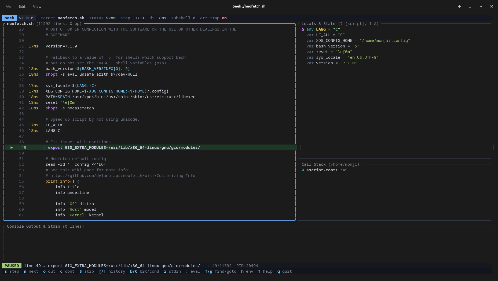

<div align="center">

# peek (`bash-peek`)

**Interactive TUI debugger, line-level profiler, and time-travel inspector for Bash scripts.**

[](https://crates.io/crates/bash-peek)
[](LICENSE)
[](https://www.gnu.org/software/bash/)
[](https://github.com/monji024/peek)

</div>

---

Debugging a 2,000-line Bash script usually means littering the file with `echo "HERE"` or turning on `set -x` and watching thousands of lines of unreadable trace scroll past your terminal. `bashdb` exists, but stepping through complex scripts in a raw CLI prompt without live variable diffs or stack visibility gets painful fast.

**`peek`** wraps your script in an isolated `DEBUG` trap harness and connects it to a Rust `ratatui` interface over anonymous UNIX FIFOs and kernel file locks. You get live local and environment state inspection, per-line execution timing, reverse step history, interactive TTY handoff, and dry-run command skipping—without touching a single line of the target script.

<p align="center">
  
</p>

## ▸ Features

* **Zero-Modification Attach:** Run `peek ./deploy.sh --arg1 val` directly. `$0` (`BASH_ARGV0`), `$@`, `$SECONDS`, `PIPESTATUS`, `shopt` options (`nocasematch`, `extdebug`), and `set -euo pipefail` semantics are preserved transparently without leaking harness internals into the variable or call-stack panes.
* **In-Bash Fast Path:** Breakpoint matching, call-stack depth checks (`next` / `out`), error traps (`$? != 0`), and conditional expressions are evaluated natively inside the Bash hook before serializing state over the FIFO. Loops run at near-native speed until a trap condition hits.
* **Subshell & Pipeline Stepping (`flock`):** Step directly into `$(...)` command substitutions and pipeline subshells (`s` to step into child shells, `n` to step over). Concurrent subshell frames are serialized via kernel file locks (`flock`) to prevent FIFO interleaving or deadlocks.
* **Fullscreen & Interactive TTY Handoff (`tcsetpgrp`):** When the target script invokes an interactive terminal program (`vim`, `nvim`, `nano`, `fzf`, `dialog`, `whiptail`, `less`, `htop`, `ssh`)—or when you press `T` (`Shift+t`) on any command—`peek` cleanly suspends the TUI, transfers foreground `/dev/tty` process-group ownership to the child without triggering `SIGTTOU`/`SIGTTIN`, and restores the debugger layout as soon as the utility exits.
* **Time-Travel Ring Buffer:** Scrub backward and forward (`[` / `]`) through the last 256 execution frames to see how variables, exit codes, and call stacks evolved prior to a failure.
* **Line Latency Heatmap:** Cumulative execution time (`µs` / `ms` / `s`) is tracked per source line right in the editor gutter to spot slow subshells or external binaries immediately.
* **Command Skipping (`extdebug`):** On a line with a destructive command (`rm`, `curl -X POST`, `kubectl delete`)? Hit `S` (`Shift+s`) to intercept and skip executing that statement via Bash's `extdebug` return hook.
* **Variable Diff Modal:** Press `Enter` on any scalar, indexed array, or associative map to inspect multiline payloads alongside a `- old` / `+ new` mutation diff from the previous frame.
* **Live REPL & `stdin` Injection:** Evaluate arbitrary Bash expressions in the paused process context (`:` or `e`) or pipe input lines directly to scripts blocked on `read` (`i`).
* **Layout-Agnostic Keybindings:** Physical QWERTY scan positions are normalized in command mode, so single-key shortcuts keep working even if your OS keyboard layout is switched to non-Latin (e.g., Persian).

## ▸ Installation

### Using Cargo (crates.io)

```bash
cargo install bash-peek
```

### Building from Source

```bash
git clone https://github.com/monji024/peek.git
cd peek
cargo build --release
sudo install -Dm755 target/release/peek /usr/local/bin/peek
```

> **Note:** Requires **Bash 4.1+** (for dynamic file descriptor allocation `{fd}>` and `$BASHPID`) and `flock` (part of `util-linux` on Linux). Linux distributions include these by default; on macOS, ensure Homebrew's `bash` is first in your `$PATH`.

## ▸ Quick Start

```bash
# Start debugging a script paused at the first executable statement
peek ./script.sh

# Pass arguments through to the target script ($1, $2, ...)
peek ./deploy.sh --env staging --force

# Pre-configure line breakpoints and automatically pause whenever $? != 0
peek -b 45,120 -e ./backup.sh
```

```text
Usage: peek [OPTIONS] <SCRIPT> [ARGS]...

Arguments:
  <SCRIPT>   Target Bash script to debug
  [ARGS]...  Arguments forwarded to the target script ($@)

Options:
  -b, --break-lines <BREAK_LINES>  Initial line breakpoints in the entry script (e.g. -b 10,24)
  -e, --break-on-error             Automatically pause whenever any command exits with non-zero status ($? != 0)
  -h, --help                       Print help
  -V, --version                    Print version
```

## ▸ Keybindings

| Key | Action |
| :--- | :--- |
| `s` / `F11` | **Step Into** next command, sourced file, or `$(...)` subshell |
| `T` (`Shift+t`) | **Step with TTY Handoff** — run current line with full foreground `/dev/tty` access |
| `n` / `F10` | **Step Over** function call or subshell at current stack depth |
| `o` | **Step Out** of current function back to caller |
| `c` / `F5` | **Continue** execution until breakpoint, condition, or error trap |
| `S` (`Shift+s`) | **Skip Command** — bypass executing the current line (`extdebug` dry-run) |
| `[` / `]` or `←` / `→` | **Time-Travel** backward / forward through recorded execution frames |
| `b` / `B` | Toggle breakpoint on cursor line / Clear all breakpoints |
| `C` (`Shift+c`) | Set native **Conditional Breakpoint** (e.g. `(( retry_count > 3 ))`) |
| `x` | Toggle automatic pause on non-zero exit code (`$? != 0`) |
| `h` | Toggle unmodified system environment variables (`[env]`) visibility |
| `Enter` | Open multiline **Value & Diff Inspector** modal for selected variable |
| `:` or `e` | **Live Eval** — run a Bash command inside the paused script's scope |
| `i` | **Send Stdin** — write a line of input to the script's standard input (`read`) |
| `/` | Filter variables by name or value substring |
| `w` | Pin / unpin a variable name to the top Watch list |
| `f` / `N` | Search text in source code / Jump to next match |
| `g` | Jump directly to a specific line number |
| `p` | Export diagnostic crash report to `./peek-report.md` |
| `r` | Restart debugging session (preserves breakpoints and watches) |
| `Tab` | Cycle focus between Source, Variables, Call Stack, and Console panes |
| `?` | Toggle keyboard reference overlay |
| `q` / `Ctrl+C` | Terminate target process group and exit |

*Mouse support:* Scroll wheel navigates the active pane; left-clicking a line number in the source gutter toggles a breakpoint (`●`).

## ▸ Architecture

```text
┌─────────────────────────────────────────┐          ┌──────────────────────────────────────────┐
│               peek (Rust)               │          │            Target Bash Process           │
│                                         │          │                                          │
│  ┌───────────┐       ┌───────────────┐  │   FIFO   │  ┌────────────────────────────────────┐  │
│  │  Ratatui  │◄──────┤ Frame Parser  │◄─┼──────────┼──┤ __peek_hook (trap DEBUG)           │  │
│  │    TUI    │       │ + Nonce Guard │  │ {state}  │  │                                    │  │
│  └─────┬─────┘       └───────┬───────┘  │          │  │  - flock subshell serialization    │  │
│        │                     │          │   FIFO   │  │  - In-Bash loop & condition checks │  │
│        ▼                     ▼          │──────────┼─►│  - Extdebug command skipping       │  │
│  ┌───────────┐       ┌───────────────┐  │  {cmd}   │  │  - Isolated shopt / flag restore   │  │
│  │  tcsetpgrp│◄─────►│ Command Queue │  │          │  └─────────────────┬──────────────────┘  │
│  │ /dev/tty  │  TTY  └───────────────┘  │          │                    │                     │
│  │  Handoff  │◄─────────────────────────┼──────────┼────────────────────┘                     │
│  └───────────┘    (vim / fzf / nano)    │          │                                          │
└─────────────────────────────────────────┘          └──────────────────────────────────────────┘
```

## ▸ License

[MIT License](LICENSE).